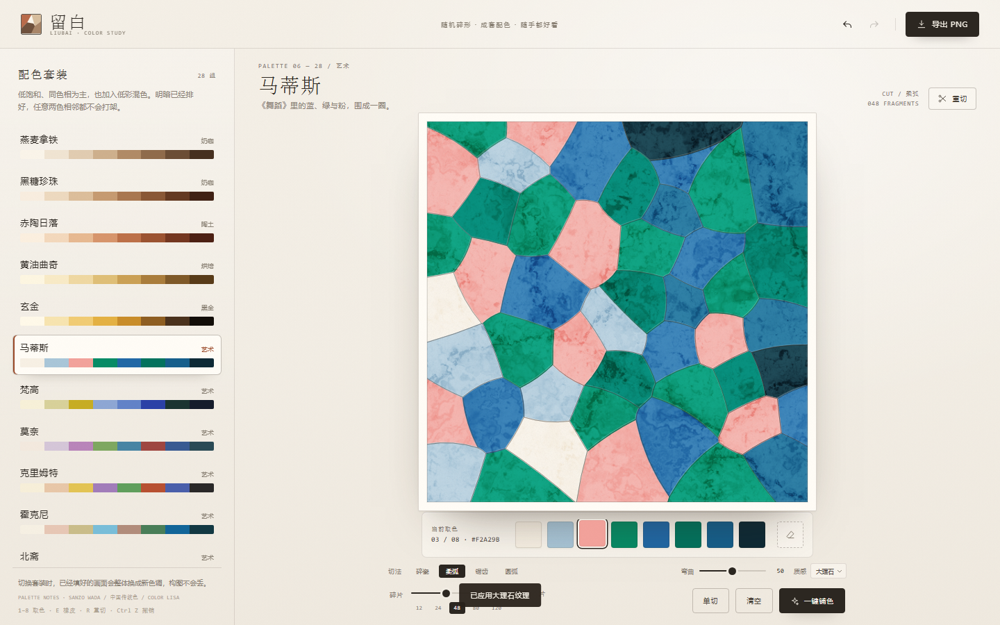
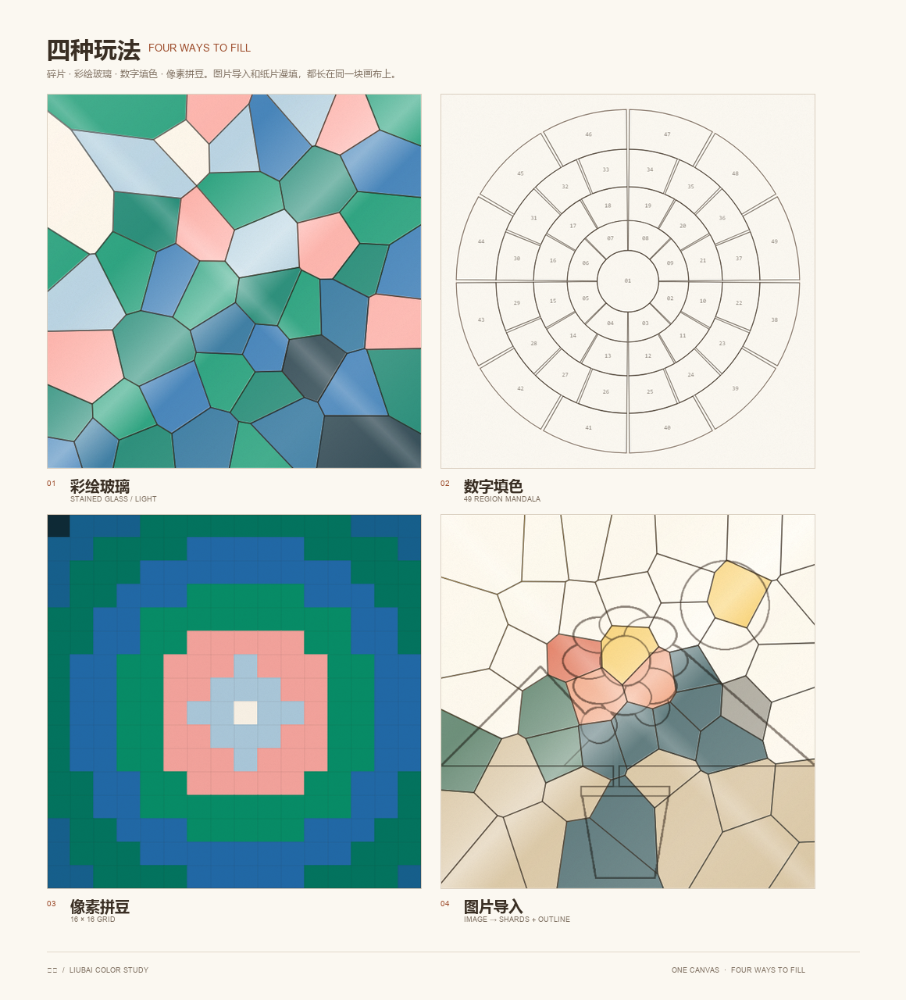

# 留白 · 填色实验室

一个随机碎形填色小游戏。**整个应用就是一个 `index.html`**：不联网、不安装、无外链依赖，双击就能玩，手机 / iPad / 电脑自适应。

> A calming fractal coloring toy for the browser. One self-contained `index.html` — no network, no build step, no dependencies. Double-click and play.




## 快速开始 / Quick start

| 方式 | 步骤 |
| --- | --- |
| 下载即用 | 下载本仓库 → 双击 `index.html`（Edge / Chrome / Safari） |
| 在线试玩 | 打开 GitHub Pages：`https://dsjsunu.github.io/liubai-coloring/` |
| 手机上玩 | 把仓库部署到任意静态托管，或把 `index.html` 传到手机用浏览器打开 |

无需 Node、Python 或任何安装步骤。所有画面、配色、纹理都在这一个文件里。

## 四种玩法

- **碎片**：随机碎形填色。四种切法、单块切割、质感、壁纸导出都在这里。
- **彩绘玻璃**：填充变半透明，铅条更粗，背景透光；顶部「点亮」会点亮画框外的暖光。
- **数字填色**：49 个编号区域的曼陀罗线稿；填色后数字消失，导出是干净色稿。
- **像素拼豆**：16 × 16 网格，一格一格填，适合头像、拼豆图纸和低分辨率像素画。
- **导入图片**（碎片 / 彩绘玻璃）：自动碎片化并提取 8 色，边缘生成可开关的参考轮廓。
- **漫填**：选好套装后点一块碎片，颜色按邻接关系铺开，并带纸片展开动画。

## 其他功能

- **28 套 × 8 色**：奶咖、花木、草木、海、夜色、黑金、青色、东方、油画、灰调，以及 6 套艺术家系列。颜色只取自套装，怎么填都不会出现脏色。
- **四种切法**：碎瓷（直边）、柔弧（曲线）、锯齿、圆弧（圆角瓷砖 + 同色系缝隙）。
- **单块切割**：点「单切」，选一块碎片再画一条切线，可连续切，`ESC` 退出，可撤销 / 重做。
- **纹理**：无 / 大理石 / 宝石 / 像素 / 玻璃 / 方块 / 水流；纹理只覆盖已填色区域，导出和壁纸也带上。
- **调色**：点按 / 拖动连续填色，支持橡皮、撤销、重做；切换套装时按明度映射，构图不丢。
- **壁纸导出**：方形原作 1600 × 1600，iPhone 与 iPad 各代原生分辨率，横竖屏可选，作品居中、柔焦填边、留出锁屏时钟区域。
- **快捷键**：`1–8` 取色、`E` 橡皮、`R` 重切、`Ctrl+Z` 撤销。

## 项目结构

```text
liubai-coloring/
├─ index.html        # 整个应用（HTML + CSS + JS + 内嵌纹理）
├─ preview*.png      # 预览图
├─ PROMPTS.md        # 需求与设计记录
├─ README.md
└─ LICENSE
```

修改配色：编辑 `index.html` 里的 `const PALETTES = [...]`，每项需 8 个颜色、按明度从浅到深排列。更完整的设计记录见 [PROMPTS.md](PROMPTS.md)。

## 许可与素材

- 代码以 [MIT](LICENSE) 许可发布。
- 大理石 / 宝石纹理来自 [ambientCG](https://ambientcg.com/) 的 CC0 材质，已转灰度并内嵌，可自由使用。
- 像素、玻璃、方块、水流为 Canvas 程序化生成的原创纹理；玻璃 / 方块只借鉴视觉语言，不使用游戏素材。
- 配色参考了公开的色彩数据集与名画取色，只取色彩关系，不使用原图。

参考资料：[Sanzo Wada 配色数据集](https://github.com/mattdesl/dictionary-of-colour-combinations) · [中国传统色](https://github.com/nevertoday/zhongguo-traditional-colors) · [Color Lisa](https://colorlisa.com/) · [iPhone 壁纸尺寸](https://tools.faxianai.com/zh/article/best-wallpaper-size-for-iphone/)

## English

A single-file fractal coloring lab. Open `index.html` in any modern browser and start coloring — no install, no network. Features 28 curated palettes, four coloring modes (fractal shards, stained glass, paint-by-number, pixel beads), image import, seven textures, and wallpaper export at native iPhone/iPad resolutions. MIT licensed.

---

如果这个项目让你放松了几分钟，欢迎点个 ⭐。
